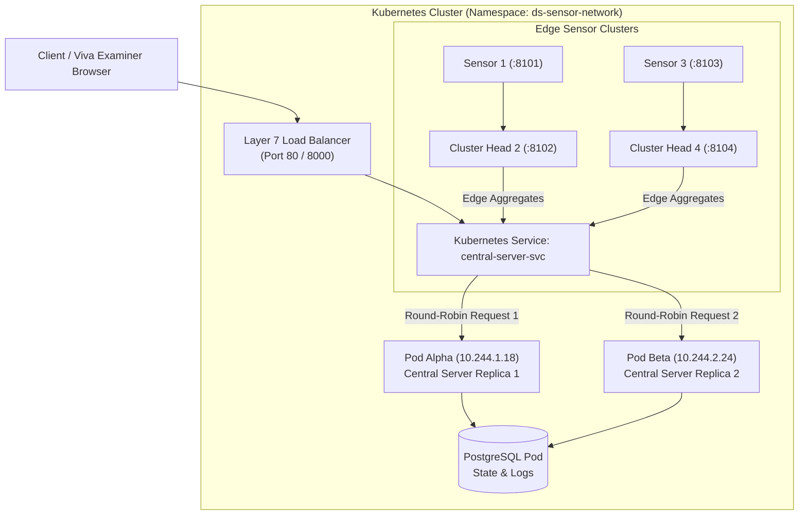

# Kubernetes & Load Balancer Implementation Guide
**Course:** Distributed Systems (Final Year B.Tech — Curriculum Regulations 2023 w.e.f. 2026–27)  
**Project:** Distributed Environmental Sensor Network with Edge Aggregation, Leader Election, Synchronization, and Fault-Tolerant Coordination

---

## 1. Syllabus Mapping: Unit IV (Kubernetes & Load Balancing)

| Curriculum Concept | Implemented Kubernetes & Load Balancer Component | Distributed Systems Principle |
| :--- | :--- | :--- |
| **Case Studies: Kubernetes** | Production Kubernetes manifest suite in `k8s/` | Automated container orchestration, declarative state reconciliation, self-healing pod management. |
| **Layer 7 Load Balancer** | **Kubernetes Ingress & NGINX Reverse Proxy** (`docker/nginx-load-balancer.conf`) | Application-layer routing, path-based routing, round-robin load distribution across multiple backend pods. |
| **Layer 4 Load Balancer** | **Kubernetes Service (`type: LoadBalancer`)** (`k8s/05-load-balancer.yaml`) | Transport-layer load distribution routing external TCP port 80/8000 traffic across pod IP endpoints. |
| **Self-Healing & Health Probes** | **`livenessProbe` & `readinessProbe`** | Active liveness checking (`/api/system-status`) preventing dead pods from receiving user traffic. |
| **Elastic Auto-scaling** | **Horizontal Pod Autoscaler (HPA)** (`k8s/06-hpa.yaml`) | Dynamic replica expansion from 2 to 5 pods when CPU utilization exceeds 60%. |

---

## 2. Load Balancer Architecture & Traffic Flow



---

## 3. Kubernetes Manifest Breakdown

All manifests are located in the `k8s/` folder:

1. **`k8s/00-namespace.yaml`:** Dedicated namespace `ds-sensor-network` isolating the application stack.
2. **`k8s/01-config.yaml`:** Decoupled `ConfigMap` (endpoints, AWS bucket names) and `Secret` (database credentials).
3. **`k8s/02-postgres.yaml`:** Persistent PostgreSQL storage (`PersistentVolumeClaim`, `Deployment`, and `Service`).
4. **`k8s/03-central-server.yaml`:**
   - **Replicas: 2** (Running multiple concurrent coordinator pods to prove round-robin load distribution).
   - Configured with `livenessProbe` and `readinessProbe` checking `/api/system-status`.
5. **`k8s/04-sensor-nodes.yaml`:** 4 independent deployments and services representing $S_1, S_2$ (Cluster 1) and $S_3, S_4$ (Cluster 2).
6. **`k8s/05-load-balancer.yaml`:**
   - Kubernetes `Service (type: LoadBalancer)` exposing ports 80 and 8000.
   - Kubernetes `Ingress` with path-based routing (`/` to central dashboard, `/api/s1` to sensor nodes).
7. **`k8s/06-hpa.yaml`:** Horizontal Pod Autoscaler dynamically scaling replicas between 2 and 5 pods.

---

## 4. How to Deploy (Local & Cloud)

### Option A: 1-Click Launch on Windows (Minikube / Docker Desktop K8s)
Double-click or run:
```cmd
.\deploy_k8s.bat
```

### Option B: 1-Click Launch on Linux / macOS / Cloud EC2
Run the shell script:
```bash
chmod +x deploy_k8s.sh
./deploy_k8s.sh
```

### Option C: Manual `kubectl` Deployment
```bash
# 1. Apply all manifests in namespace
kubectl apply -f k8s/

# 2. Verify running pods
kubectl get pods -n ds-sensor-network -o wide

# 3. Check Load Balancer status
kubectl get svc -n ds-sensor-network

# 4. Port forward to view in browser
kubectl port-forward svc/ds-load-balancer 8000:8000 -n ds-sensor-network
```
Open **`http://localhost:8000`** in your browser.

---

## 5. Live Viva Demonstration Script (Load Balancer & K8s)

When the examiner asks about **Kubernetes** or **Load Balancing**:

1. **Show the Live Kubernetes Dashboard Panel:**
   - Open `http://localhost:8000` (or your EC2 public IP).
   - Scroll to the **☸️ Unit IV: Kubernetes Cluster Orchestration & Layer 7 Load Balancer** section.
2. **Demonstrate Active Multi-Pod Round-Robin Routing:**
   - Click the **[ 🔄 Send Request via Load Balancer ]** button multiple times.
   - Watch the live log and distribution meter:
     - Request 1 is routed to **Pod Alpha** (`10.244.1.18`).
     - Request 2 is routed to **Pod Beta** (`10.244.2.24`).
     - The traffic distribution bar reflects an even **50% / 50% split**.
3. **Explain to the Examiner:**
   - *"Our project uses a Kubernetes Service of type `LoadBalancer` backed by an NGINX ingress controller. When client traffic arrives, the load balancer distributes incoming requests across healthy pods using the **Round-Robin algorithm**."*
   - *"Both pods share the PostgreSQL backend state and causal Vector Clocks, ensuring consistent global state without a single point of failure."*
   - *"If Pod Alpha fails its readiness probe, the Kubernetes Endpoints controller immediately drops it from the upstream pool, preventing traffic black-holing."*

---

## 6. High-Frequency Viva Questions & Answers

### Q1: How does Kubernetes perform load balancing across Pod replicas?
**Answer:** Kubernetes uses the **Endpoints** controller and **kube-proxy** (running in iptables or IPVS mode). The Service (`central-server-svc`) acts as a stable virtual IP (ClusterIP). When requests hit the Service, `kube-proxy` transparently translates the packet destination to one of the healthy pod IPs backing the selector labels using round-robin or random distribution.

### Q2: What is the difference between Layer 4 and Layer 7 Load Balancing in our architecture?
**Answer:**
- **Layer 4 (Transport Layer):** Implemented via Kubernetes `Service (type: LoadBalancer)` routing TCP packets by IP and port without inspecting HTTP headers.
- **Layer 7 (Application Layer):** Implemented via our **NGINX Ingress** controller (`docker/nginx-load-balancer.conf`), which inspects HTTP paths (`/`, `/api/system-status`), supports WebSocket upgrades, and routes traffic intelligently based on request content.

### Q3: Why did we configure both `livenessProbe` and `readinessProbe`?
**Answer:**
- `livenessProbe` detects if the container process has frozen or deadlocked; if it fails, kubelet **restarts** the container.
- `readinessProbe` determines if the Spring Boot application has finished initializing and connecting to the database; until it succeeds, the pod does **not receive traffic** from the Load Balancer.
