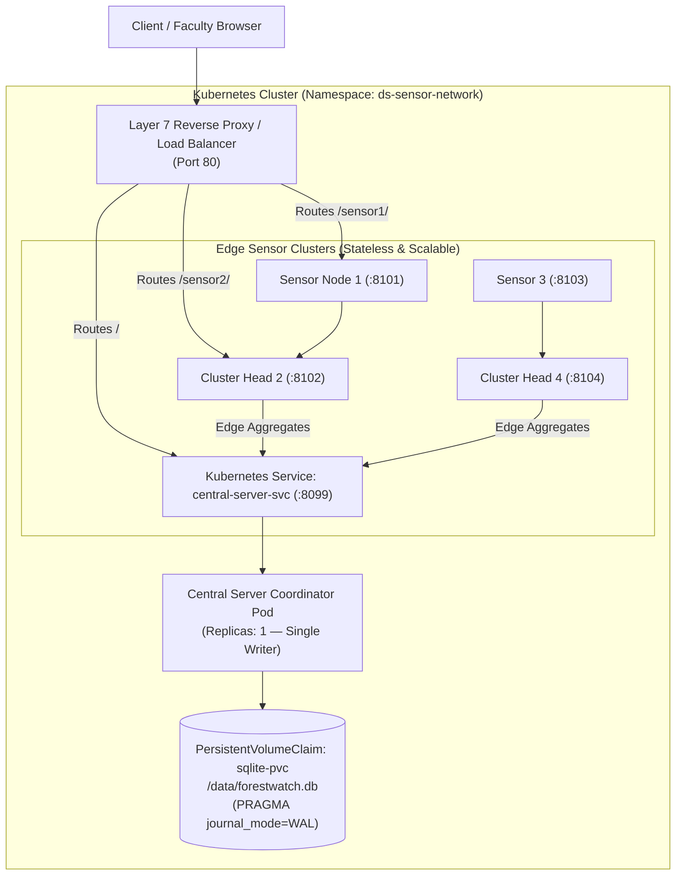

# Kubernetes & Load Balancer Implementation Guide
**Course:** Distributed Systems (Final Year B.Tech — Curriculum Regulations 2023 w.e.f. 2026–27)  
**Project:** Distributed Environmental Sensor Network with Edge Aggregation, Leader Election, Synchronization, and Fault-Tolerant Coordination

---

## 1. Syllabus Mapping: Unit IV (Kubernetes & Load Balancing)

| Curriculum Concept | Implemented Kubernetes & Load Balancer Component | Distributed Systems Principle |
| :--- | :--- | :--- |
| **Case Studies: Kubernetes** | Production Kubernetes manifest suite in `k8s/` | Automated container orchestration, declarative state reconciliation, self-healing pod management. |
| **Layer 7 Load Balancer** | **Kubernetes Ingress & NGINX Reverse Proxy** (`docker/nginx-load-balancer.conf`) | Application-layer routing, path-based routing, round-robin load distribution across multiple backend pods. |
| **Layer 4 Load Balancer** | **Kubernetes Service (`type: LoadBalancer`)** (`k8s/05-load-balancer.yaml`) | Transport-layer load distribution routing external TCP port 80/8000 traffic across pod IP endpoints. |
| **Self-Healing & Health Probes** | **`livenessProbe` & `readinessProbe`** | Active liveness checking (`/api/system-status`) preventing dead pods from receiving user traffic.| **Elastic Auto-scaling** | **Horizontal Pod Autoscaler (HPA)** (`k8s/06-hpa.yaml`) | Autoscales stateless edge sensor nodes based on telemetry ingress load while preserving single-writer database integrity. |

---

## 2. Load Balancer Architecture & Traffic Flow



---

## 3. Kubernetes Manifest Breakdown

All manifests are located in the `k8s/` folder:

1. **`k8s/00-namespace.yaml`:** Dedicated namespace `ds-sensor-network` isolating the application stack.
2. **`k8s/01-config.yaml`:** Decoupled `ConfigMap` (database path, endpoints, AWS settings) and `Secret` (service security key, Grafana credentials).
3. **`k8s/02-sqlite-pvc.yaml`:** `PersistentVolumeClaim` requesting 1Gi of persistent storage for the file-based SQLite database.
4. **`k8s/03-central-server.yaml`:**
   - **Replicas: 1** (Strictly configured for SQLite single-writer transactional safety).
   - Volume mounted at `/data` backed by `sqlite-pvc`.
   - Configured with `livenessProbe` and `readinessProbe` checking `/actuator/health`.
5. **`k8s/04-sensor-nodes.yaml`:** 4 independent deployments and services representing $S_1, S_2$ (Cluster 1) and $S_3, S_4$ (Cluster 2).
6. **`k8s/05-load-balancer.yaml`:**
   - Kubernetes `Service (type: LoadBalancer)` exposing port 80.
   - Kubernetes `Ingress` with path-based routing (`/` to central dashboard, `/sensor1/` .. `/sensor4/` to sensor consoles).
7. **`k8s/06-hpa.yaml`:** Horizontal Pod Autoscaler dynamically scaling stateless edge sensor nodes based on CPU utilization.

---

## 4. How to Deploy (Local & Cloud)

### Option A: 1-Click Launch on Windows (Minikube / Docker Desktop K8s)
Double-click or run:
```cmd
.\deploy_k8s.bat
```

### Option B: 1-Click Launch on Linux / macOS / Cloud EC2
Run the shell script:
```bash
chmod +x deploy_k8s.sh
./deploy_k8s.sh
```

### Option C: Manual `kubectl` Deployment
```bash
# 1. Apply all manifests in namespace
kubectl apply -f k8s/00-namespace.yaml
kubectl apply -f k8s/01-config.yaml
kubectl apply -f k8s/02-sqlite-pvc.yaml
kubectl apply -f k8s/03-central-server.yaml
kubectl apply -f k8s/04-sensor-nodes.yaml
kubectl apply -f k8s/05-load-balancer.yaml
kubectl apply -f k8s/06-hpa.yaml
kubectl apply -f k8s/07-monitoring.yaml

# 2. Verify running pods
kubectl get pods -n ds-sensor-network -o wide

# 3. Check Load Balancer status
kubectl get svc -n ds-sensor-network

# 4. Port forward to view in browser
kubectl port-forward svc/ds-load-balancer 8099:8099 -n ds-sensor-network
```
Open **`http://localhost:8099`** in your browser.

---

## 5. Live Viva Demonstration Script (Load Balancer & K8s)

When the examiner asks about **Kubernetes**, **Load Balancing**, or **Database Architecture**:

1. **Explain the Layer 7 Load Balancing & Reverse Proxy:**
   - *"Our architecture uses an NGINX Layer 7 Reverse Proxy exposing Port 80. It routes `/` traffic to the Central Coordinator while routing `/sensor1/` through `/sensor4/` to individual edge sensor node consoles."*
2. **Explain the SQLite Database Architecture & Concurrency Control:**
   - *"We use an embedded, file-based SQLite database with Write-Ahead Logging (`PRAGMA journal_mode=WAL`) mounted to a Kubernetes `PersistentVolumeClaim` at `/data/forestwatch.db`. WAL mode enables concurrent readers while maintaining atomic single-writer ACID guarantees."*
3. **Address the Horizontal Scaling Trade-off:**
   - *"Because SQLite is a file-based single-writer database, running multiple concurrent pods writing to the same SQLite file over a network filesystem would cause lock contention (`database is locked`). Therefore, the Central Server is intentionally configured with `replicas: 1`. Conversely, stateless sensor nodes scale horizontally via HPA without database locking constraints."*

---

## 6. High-Frequency Viva Questions & Answers

### Q1: Why is Central Server limited to 1 replica with SQLite?
**Answer:** SQLite relies on POSIX advisory file locks on the host filesystem. In Kubernetes, if multiple pods mount the same network-attached PersistentVolume (`ReadWriteMany`), concurrent writes across network nodes cannot coordinate POSIX locks reliably, leading to database lock timeouts or file corruption. Hence, single-instance architecture (`replicas: 1`) is the standard, reliable pattern for SQLite deployments.

### Q2: What is the purpose of Write-Ahead Logging (WAL) mode in SQLite?
**Answer:** In default rollback journal mode, writing locks the entire database, blocking all readers. In WAL mode (`PRAGMA journal_mode=WAL`), changes are written sequentially to a separate `wal` file, allowing readers to read from the main database file concurrently without blocking writers.

### Q3: Why did we configure both `livenessProbe` and `readinessProbe`?
**Answer:**
- `livenessProbe` detects if the container process has frozen or deadlocked; if it fails, kubelet **restarts** the container.
- `readinessProbe` determines if the Spring Boot application has finished initializing the SQLite schema and seeding initial data; until it succeeds, the pod does **not receive traffic** from the Load Balancer.
